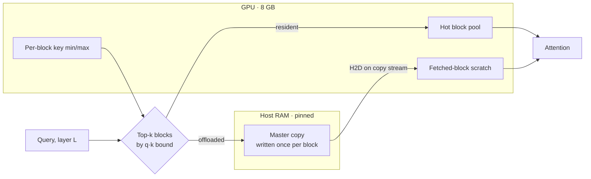

<!-- GENERATED by scripts/render_docs.py from docs/templates/README.md.tmpl. Edit the template, not this file. Numbers come from results/**/metrics.json. -->

<div align="center">

# LazyKV

**A tiered KV-cache runtime and residency-policy study for long-context LLM inference on one 8 GB laptop GPU.**


[](https://github.com/PS12007/LazyKV/actions/workflows/tests.yml)

[Findings](docs/FINDINGS.md) · [Paper draft](docs/PAPER.md) · [Research log](docs/RESEARCH_LOG.md) · [Related work](docs/RELATED_WORK.md)

</div>

---

LazyKV treats VRAM as a cache over a KV cache held in pinned host RAM, then asks one question:
**under a fixed GPU KV budget, how much context and quality can block residency, migration,
compression and prefetching keep?**

It is not a new mechanism. Query-aware selection, CPU offload and layer-ahead prefetch already
exist (Quest, ArkVale, InfiniGen; see [related work](docs/RELATED_WORK.md)). What this repo adds is
a controlled comparison of those ideas on consumer hardware: one model, one budget sweep, the same
prompts and metrics for every policy, and the negative results kept in.

## Results

Needle-in-a-haystack (NIAH) accuracy at 32,768 tokens on Llama-3.2-1B,
as a share of the full cache's (88.9% over
45 prompts), at each policy's best budget:

| Rung | Policy | Best retention | VRAM freed |
|---|---|---|---|
| 2 | Sliding window + attention sink | 62.5% at 75% | the budget |
| 3 | Block LRU | 29.4% at 75% | the budget |
| 4 | H2O-style eviction | 92.5% at 75% | the budget |
| 5 | Quest-style query-aware selection | 98.8% at 75% | none (attends to less, keeps everything) |
| 6 | + pinned CPU tier | rung 5's answers, bit for bit | 415 MiB resident at 25%, vs 1,028 MiB |
| 7 | + layer-ahead prefetch | same answers | same, but slower than rung 6 |
| 8 | + int8 warm/cold tier | same within noise (p = 0.39) | same, at 0.531× the host bytes |
| 9 | + exact CPU attention merge | **100.0%–101.3% at every budget** | same, plus 1,848 MiB host RAM; 6.1–6.5× slower than full |

<picture>
  <source media="(prefers-color-scheme: dark)" srcset="docs/figures/ladder_pareto-dark.png">
  
</picture>

**1. No policy that skips KV holds 99% of full-cache accuracy below a 100% budget.** Query-aware
selection comes closest. On 300 paired prompts it fails the
bar at 50% (95% CI 94.7%–98.9%)
and sits on it at 75% (CI 97.6%–100.2%).
Rung 9 clears it by computing the missing attention on the CPU and merging it exactly: the last
percent of accuracy is available, but it costs compute, not memory.

**2. Moving fewer bytes never made decode faster.** At 25% the tier moves
4.6 MiB per token, well under a
millisecond of PCIe time, while bringing each layer's top-K indices back to the host costs
5.0–6.8 ms.
Fewer fetches, fully hidden prefetch (100%
overlap) and an int8 tier that halves traffic were all no faster. Decode is bound by the host
deciding what to move.

**3. Taking the host out of the loop fixes it at small budgets.** A zero-copy tier ([Phase 23](docs/phases/PHASE_23.md))
maps pinned memory into the GPU's address space and gathers selected blocks in place, with no
residency table and no sync. At 6.25% it decodes at rung 5's speed
(1.82× rung 6); at 50% it is
0.39× rung 6, because it rereads every selected
block every step.

### Beyond the ladder

| | Result |
|---|---|
| Perplexity as a proxy ([10](docs/phases/PHASE_10.md)) | 9 of 20 conditions lose ≥ 10% of NIAH retrieval with no detectable perplexity change; the window at 25% keeps 24.4% of retrieval at 1.024× perplexity |
| Multi-hop retrieval ([12](docs/phases/PHASE_12.md), [13](docs/phases/PHASE_13.md)) | at 6.25%, query-aware selection keeps 41.5% on RULER variable tracking vs 61.3% on the single needle |
| LongBench QA ([14](docs/phases/PHASE_14.md)) | no multi-hop shortfall detected: 77.2% of multi-hop F1 vs 78.6% single-doc at 6.25%, wide intervals |
| A 3B model ([15](docs/phases/PHASE_15.md)) | at 6.25%, selection keeps 76.7% of Llama-3.2-3B's accuracy vs 42.9% of the 1B's |
| Tiered prefill ([17](docs/phases/PHASE_17.md)) | runs 130,048 tokens on the 1B (full cache: 98,304) and 65,536 on the 3B (full cache: 32,768), bit-identical to the full-cache path; neither limit was reached |
| Multi-turn sessions ([19](docs/phases/PHASE_19.md), [21](docs/phases/PHASE_21.md)) | reading each turn densely lifts later-turn accuracy at 6.25% from 24.3% to 72.9% |
| Session snapshots ([20](docs/phases/PHASE_20.md), [22](docs/phases/PHASE_22.md)) | resuming from NVMe is 8.9–25.9× faster than re-prefilling; a later restore path is another 1.56–1.57× quicker |
| float32 ranking bound ([24](docs/phases/PHASE_24.md)) | negative: no measurable effect on quality, default stays bf16 |

The full argument, with confidence intervals and limitations, is in [FINDINGS.md](docs/FINDINGS.md).

## How it works



KV is split into 64-token blocks. Each block keeps a per-channel key min/max on the GPU, so a query
can bound its attention score to every block without touching the block itself. The top-k blocks
are attended; any not resident in VRAM are fetched from a pinned host copy. Everything plugs into
Hugging Face Transformers through one `Cache` subclass and one attention override.

Why selection rather than dense offload: on this laptop, fetching a layer's KV over PCIe costs
about 11× the attention it feeds
at 64K tokens, and VRAM is only 4.9×
faster than pinned PCIe. Hardware measurements are in [SYSTEM_INFO.md](SYSTEM_INFO.md).

## Quickstart

Windows 11, Python 3.12, an NVIDIA driver with CUDA 13 support.

```powershell
git clone https://github.com/PS12007/LazyKV; cd LazyKV
uv venv --python 3.12 .venv
uv pip install --python .venv\Scripts\python.exe -r requirements.lock `
  --index-url https://download.pytorch.org/whl/cu130 `
  --extra-index-url https://pypi.org/simple --index-strategy unsafe-best-match
uv pip install --python .venv\Scripts\python.exe --no-deps -e .
.venv\Scripts\python.exe examples\tiered_decode.py --context 16384 --budget 0.25
```

The example prefills one long prompt, decodes it from the full GPU cache and from the CPU tier,
and prints VRAM held, decode speed and the answer for each.

The `lazykv` package is the runtime (caches, policies, CPU tier, quality metrics). The benchmark
tooling in `harness/`, `scripts/` and `configs/` runs from a clone. It is a research runtime, not an
inference engine: the CPU tier decodes slower than the full cache, and it has only been run on
Llama-3.2 with one pinned Transformers version.

## Reproducing

Every result records the command, commit and flags that produced it, so reproduction reads from the
data rather than from this file:

```powershell
.venv\Scripts\python.exe scripts\reproduce.py plan --phase 4                  # print the exact driver commands
.venv\Scripts\python.exe scripts\reproduce.py chain --phase 4 --out run.cmd   # write them as a detachable chain
.venv\Scripts\python.exe scripts\reproduce.py analyze                         # rerun analyses, figures and docs
```

Drivers take minutes to hours, so run them detached with output to `logs/`. Weights (about 2.5 GB
for the 1B model) download on first use. Pass `--quick` for a smoke test; its output is never
reported.

No number in any markdown file is typed by hand. Prose lives in `docs/templates/*.md.tmpl`;
`scripts/render_docs.py` fills placeholders from `results/**/metrics.json`, missing values render as
*not measured*, and a test fails if a committed doc drifts from its data.

### Measurement discipline

A laptop throttles, downclocks within seconds of idling and retrains its PCIe link on demand, so
every benchmark:

- reports **median and IQR** after warmup, repeated as **independent processes**;
- **interleaves and randomizes** conditions so thermal drift can't line up with one;
- times GPU work with **CUDA events** and logs temperature, clocks and link state throughout;
- scores quality on a **bit-repeatable** kernel (cuDNN decode is not), checked against a reference;
- opts out of **Windows power throttling**, which otherwise moves a detached run onto E-cores.

## Repository

| Path | |
|---|---|
| `lazykv/` | Runtime: caches, block pool, residency policies, CPU tier, kernels, quality metrics |
| `harness/` | Stats, telemetry, GPU memory guard, host scheduling, metrics I/O, template renderer |
| `scripts/` · `configs/` | Benchmark drivers, analyses, figures; one YAML per phase |
| `results/` | Raw `metrics.json` and telemetry for every reported run |
| [`docs/phases/`](docs/phases) | One report per phase (0–24), with method and provenance |
| [`docs/FINDINGS.md`](docs/FINDINGS.md) | The study in one document |
| [`docs/RESEARCH_LOG.md`](docs/RESEARCH_LOG.md) | Dated notes, including mistakes caught |
| [`SYSTEM_INFO.md`](SYSTEM_INFO.md) | Machine inventory and hardware microbenchmarks |
| [`AGENTS.md`](AGENTS.md) | Project rules: no hand-typed numbers, verified citations, phase gates |

## Scope

One machine (an RTX 5060 Laptop, see [SYSTEM_INFO.md](SYSTEM_INFO.md)), single request, single GPU.
Out of scope: batching, cross-request prefix caching, custom CUDA kernels, and competing with vLLM
on throughput. There is no SSD tier on the latency path: NVMe is
9.9× slower than pinned PCIe sequentially.
The 1B model's full 64K cache fits in VRAM, so the budget is an imposed constraint that makes
policies comparable, not a physical limit.

## License

[MIT](LICENSE). Contributions, especially reproductions on other GPUs, are welcome; see
[CONTRIBUTING.md](CONTRIBUTING.md).
