<!-- GENERATED by scripts/render_docs.py from docs/templates/README.md.tmpl. Edit the template, not this file. Numbers come from results/**/metrics.json. -->

<div align="center">

# LazyKV

**A tiered KV-cache runtime and residency-policy study for long-context LLM inference on one 8 GB laptop GPU.**


[](https://github.com/PS12007/LazyKV/actions/workflows/tests.yml)


[Findings](docs/FINDINGS.md) · [Paper draft](docs/PAPER.md) · [Phase reports](docs/phases) · [Research log](docs/RESEARCH_LOG.md) · [Related work](docs/RELATED_WORK.md)

| **130,048** | **100.0%** | **1.82×** | **25.9×** |
|:---:|:---:|:---:|:---:|
| tokens of context on the 1B,<br/>full cache stops at 98,304 | of full-cache accuracy kept by<br/>the exact tier, at every budget | faster decode than the host-driven<br/>tier at a 6.25% budget (zero-copy) | faster to resume a session<br/>from NVMe than to prefill again |

</div>

---

LazyKV treats VRAM as a cache over a KV cache held in pinned host RAM, then asks one question:
**under a fixed GPU KV budget, how much context and quality can block residency, migration,
compression and prefetching keep?**

It is not a new mechanism. Query-aware selection, CPU offload and layer-ahead prefetch already
exist (Quest, ArkVale, InfiniGen; see [related work](docs/RELATED_WORK.md)). What this repo adds is
a controlled comparison of those ideas on consumer hardware: one model, one budget sweep, the same
prompts and metrics for every policy, 25 gated phases, and the negative results kept in.

**Contents:** [Results](#results) · [What's in the runtime](#whats-in-the-runtime) ·
[How it works](#how-it-works) · [Quickstart](#quickstart) · [Reproducing](#reproducing) ·
[Repository](#repository) · [Scope](#scope) · [Citation](#citation)

## Results

Needle-in-a-haystack (NIAH) accuracy at 32,768 tokens on Llama-3.2-1B,
as a share of the full cache's (88.9% over
45 prompts), at each policy's best budget. Each rung
adds one mechanism to the one before it:

| Rung | Policy | Best retention | VRAM freed |
|---|---|---|---|
| 2 | Sliding window + attention sink | 62.5% at 75% | the budget |
| 3 | Block LRU | 29.4% at 75% | the budget |
| 4 | H2O-style eviction | 92.5% at 75% | the budget |
| 5 | Quest-style query-aware selection | 98.8% at 75% | none (attends to less, keeps everything) |
| 6 | + pinned CPU tier | rung 5's answers, bit for bit | 415 MiB resident at 25%, vs 1,028 MiB |
| 7 | + layer-ahead prefetch | same answers | same, but slower than rung 6 |
| 8 | + int8 warm/cold tier | same within noise (p = 0.39) | same, at 0.531× the host bytes |
| 9 | + exact CPU attention merge | **100.0%–101.3% at every budget** | same, plus 1,848 MiB host RAM; 6.1–6.5× slower than full |

<picture>
  <source media="(prefers-color-scheme: dark)" srcset="docs/figures/ladder_pareto-dark.png">
  
</picture>

### 1. No policy that skips KV holds 99% of full-cache accuracy below a 100% budget

Query-aware selection comes closest. On 300 paired prompts it
fails the bar at 50% (95% CI 94.7%–98.9%)
and sits on it at 75% (CI 97.6%–100.2%).
Rung 9 clears it by computing the missing attention on the CPU and merging it exactly: the last
percent of accuracy is available, but it costs compute, not memory.

The policies fail in different places, and needle depth is what separates them: a window keeps the
end of the prompt, accumulated attention keeps the beginning and the end, and query-aware selection
keeps whatever the current query points at.

<picture>
  <source media="(prefers-color-scheme: dark)" srcset="docs/figures/p3_depth-dark.png">
  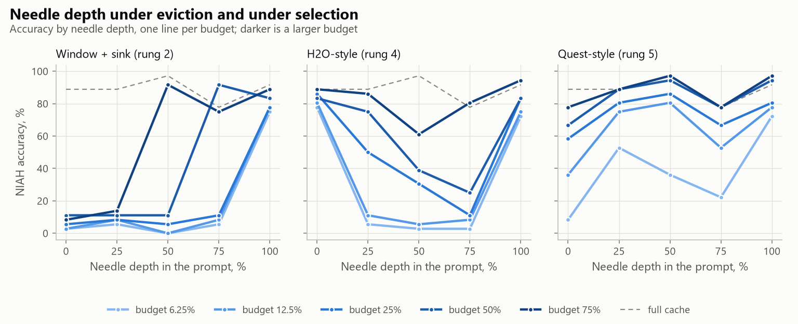
</picture>

### 2. Moving fewer bytes never made decode faster

At 25% the tier moves 4.6 MiB per token,
well under a millisecond of PCIe time, while bringing each layer's top-K indices back to the host
costs 5.0–6.8 ms.
Fewer fetches, fully hidden prefetch (100%
overlap) and an int8 tier that halves traffic were all no faster. Decode is bound by the host
deciding what to move, not by the link.

<picture>
  <source media="(prefers-color-scheme: dark)" srcset="docs/figures/p4_tradeoff-dark.png">
  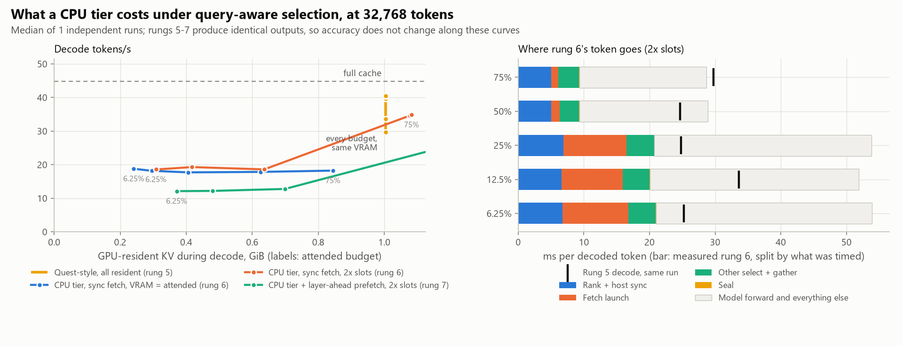
</picture>

### 3. Taking the host out of the loop fixes it at small budgets

A zero-copy tier ([Phase 23](docs/phases/PHASE_23.md)) maps pinned memory into the GPU's address
space and gathers selected blocks in place, with no residency table and no sync. At 6.25% it decodes
at rung 5's speed (1.82× rung 6) while holding
less VRAM than rung 6 at every budget; at 50% it drops to 0.39×
rung 6, because it rereads every selected block every step. Its answers match rung 5's on
90 of 90 prompts.

<picture>
  <source media="(prefers-color-scheme: dark)" srcset="docs/figures/p23_zerocopy-dark.png">
  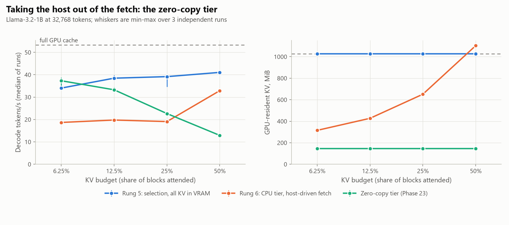
</picture>

### 4. The tier turns host RAM into context

Prefilling layer by layer straight into the tier ([Phase 17](docs/phases/PHASE_17.md)) means the
full KV never sits in VRAM at once. It is bit-identical to the full-cache path, and the model runs
contexts its full cache cannot. Saved to disk, that host store resumes a session far faster than
prefilling again ([Phases 20](docs/phases/PHASE_20.md) and [22](docs/phases/PHASE_22.md)), with the
restored state hash matching the prefilled one on 18 of
18 restores.

<picture>
  <source media="(prefers-color-scheme: dark)" srcset="docs/figures/p17_capacity-dark.png">
  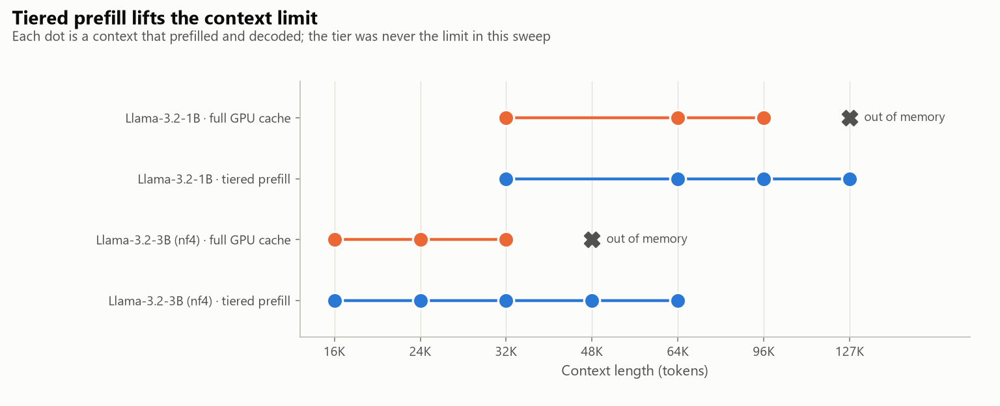
</picture>

<picture>
  <source media="(prefers-color-scheme: dark)" srcset="docs/figures/p22_snapshot-dark.png">
  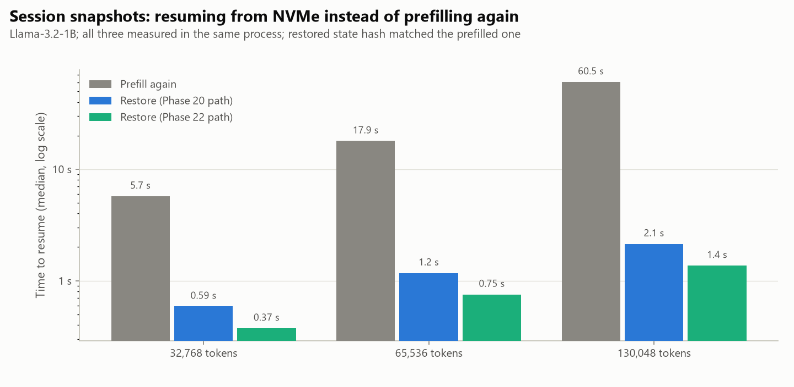
</picture>

### Beyond the ladder

| | Result |
|---|---|
| Perplexity as a proxy ([10](docs/phases/PHASE_10.md)) | 9 of 20 conditions lose ≥ 10% of NIAH retrieval with no detectable perplexity change; the window at 25% keeps 24.4% of retrieval at 1.024× perplexity |
| Multi-hop retrieval ([12](docs/phases/PHASE_12.md), [13](docs/phases/PHASE_13.md)) | at 6.25%, query-aware selection keeps 41.5% on RULER variable tracking vs 61.3% on the single needle |
| LongBench QA ([14](docs/phases/PHASE_14.md)) | no multi-hop shortfall detected: 77.2% of multi-hop F1 vs 78.6% single-doc at 6.25%, wide intervals |
| A 3B model ([15](docs/phases/PHASE_15.md)) | at 6.25%, selection keeps 76.7% of Llama-3.2-3B's accuracy vs 42.9% of the 1B's |
| Multi-turn sessions ([19](docs/phases/PHASE_19.md), [21](docs/phases/PHASE_21.md)) | reading each turn densely lifts later-turn accuracy at 6.25% from 24.3% to 72.9% |
| Snapshot restore ([20](docs/phases/PHASE_20.md), [22](docs/phases/PHASE_22.md)) | 8.9–25.9× faster than re-prefilling; a later restore path is another 1.56–1.57× quicker |
| float32 ranking bound ([24](docs/phases/PHASE_24.md)) | negative: no measurable effect on quality, default stays bf16 |

<details>
<summary><b>More figures:</b> model size, multi-hop retrieval, perplexity, context length</summary>

<picture>
  <source media="(prefers-color-scheme: dark)" srcset="docs/figures/p15_models-dark.png">
  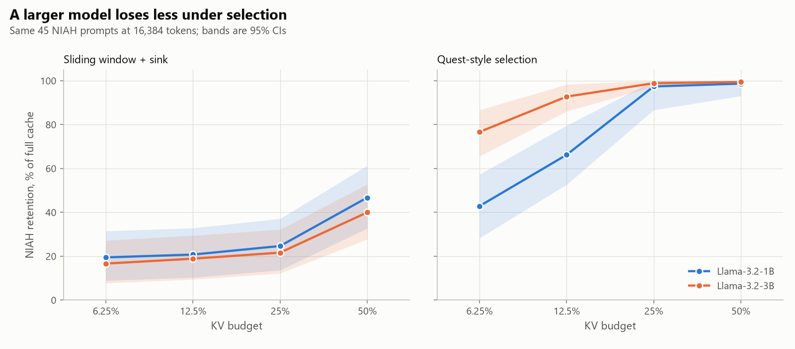
</picture>

<picture>
  <source media="(prefers-color-scheme: dark)" srcset="docs/figures/p12_ruler-dark.png">
  
</picture>

<picture>
  <source media="(prefers-color-scheme: dark)" srcset="docs/figures/p10_perplexity-dark.png">
  
</picture>

<picture>
  <source media="(prefers-color-scheme: dark)" srcset="docs/figures/p8_context-dark.png">
  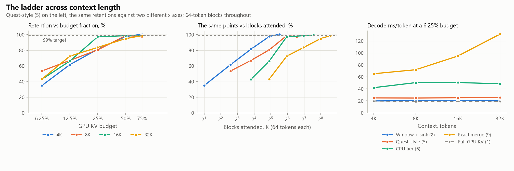
</picture>

</details>

The full argument, with confidence intervals and limitations, is in [FINDINGS.md](docs/FINDINGS.md).

## What's in the runtime

| Component | Module | |
|---|---|---|
| Preallocated full-GPU cache | `lazykv/cache.py` | the reference every policy is scored against |
| Residency policies | `lazykv/policies.py`, `lazykv/selection.py` | window + sink, block LRU, H2O-style, Quest-style |
| Pinned CPU tier | `lazykv/tiered.py`, `lazykv/pinned.py` | synchronous, prefetching and zero-copy fetch paths |
| int8 warm/cold tier | `lazykv/quant.py` | quantized host copy behind an exact hot tier |
| Exact CPU attention merge | `lazykv/exact.py` | partial attention on the host, merged by log-sum-exp |
| Tiered prefill | `lazykv/tiered_prefill.py` | layer-major prefill straight into the tier |
| Session snapshots | `lazykv/snapshot.py` | save and restore a tier's host store from disk |
| Multi-turn sessions | `lazykv/multiturn.py` | a document then a conversation that keeps adding to the KV |
| Quality metrics | `lazykv/quality.py`, `lazykv/niah.py`, `lazykv/longbench.py` | teacher-forced KL, top-1 agreement, NIAH, RULER, LongBench |
| Offline replay simulator | `lazykv/residency_sim.py`, `lazykv/trace.py` | policies against an optimal oracle on recorded traces |

## How it works

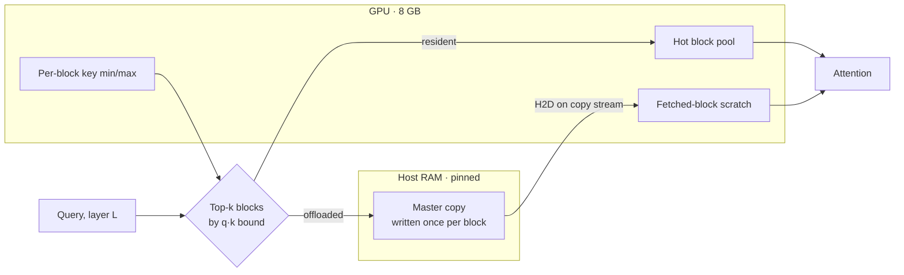

KV is split into 64-token blocks. Each block keeps a per-channel key min/max on the GPU, so a query
can bound its attention score to every block without touching the block itself. The top-k blocks
are attended; any not resident in VRAM are fetched from a pinned host copy. Everything plugs into
Hugging Face Transformers through one `Cache` subclass and one attention override.

Why selection rather than dense offload: on this laptop, fetching a layer's KV over PCIe costs
about 11× the attention it feeds
at 64K tokens, and VRAM is only 4.9×
faster than pinned PCIe (26.52 GB/s).

<details>
<summary><b>Hardware measurements</b> behind that choice</summary>

<picture>
  <source media="(prefers-color-scheme: dark)" srcset="docs/figures/bandwidth_ladder-dark.png">
  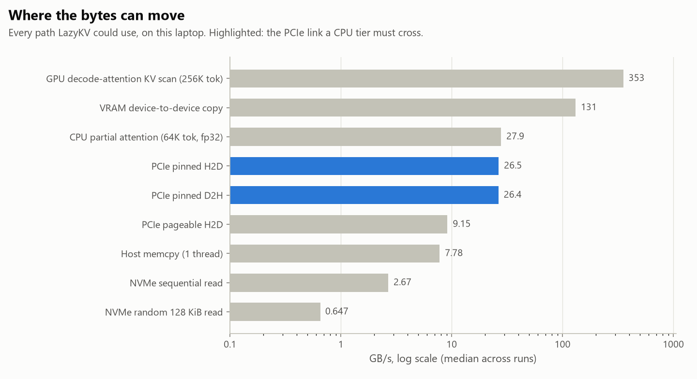
</picture>

<picture>
  <source media="(prefers-color-scheme: dark)" srcset="docs/figures/design_costs-dark.png">
  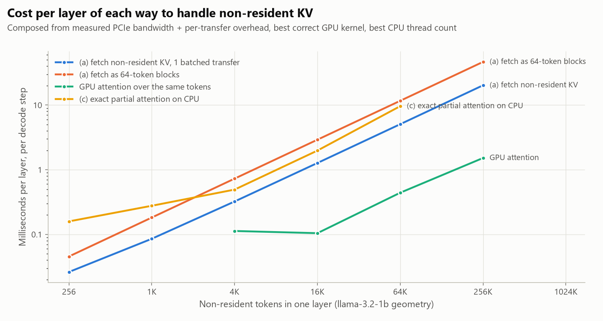
</picture>

All values are medians of independent runs; full method and ranges in [SYSTEM_INFO.md](SYSTEM_INFO.md).

</details>

## Quickstart

Windows 11, Python 3.12, an NVIDIA driver with CUDA 13 support.

```powershell
git clone https://github.com/PS12007/LazyKV; cd LazyKV
uv venv --python 3.12 .venv
uv pip install --python .venv\Scripts\python.exe -r requirements.lock `
  --index-url https://download.pytorch.org/whl/cu130 `
  --extra-index-url https://pypi.org/simple --index-strategy unsafe-best-match
uv pip install --python .venv\Scripts\python.exe --no-deps -e .
.venv\Scripts\python.exe examples\tiered_decode.py --context 16384 --budget 0.25
```

The example prefills one long prompt, then decodes it from the full GPU cache and from the CPU
tier and prints the VRAM, speed and answer for each. The core of it:

```python
from lazykv.cache import FullGPUCache
from lazykv.generate import greedy_decode, load, prefill
from lazykv.sweep import Condition, build_cache, make_host_memory

lm = load("unsloth/Llama-3.2-1B-Instruct", REVISION)
full = FullGPUCache(lm.num_layers, max_len)
conds = [Condition("full", 1.0), Condition("tiered_sync", 0.25)]
host = make_host_memory(conds, lm.model, 64, full.max_len, full.max_len, TIER)
pre = prefill(lm.model, full, ids, chunk_size=2048)

built = build_cache(full, conds[1], total, 64, model=lm.model, host=host, tier=TIER)
out = greedy_decode(lm.model, built.cache, pre.last_logits, new_tokens)
print(built.cache.stats().gpu_resident_kv_bytes)
```

Every cache is a `transformers.Cache`, so it also works with a model's own forward pass. The
`lazykv` package is the runtime; the benchmark tooling in `harness/`, `scripts/` and `configs/`
runs from a clone. It is a research runtime, not an inference engine: it has only been run on
Llama-3.2 with one pinned Transformers version.

## Reproducing

Every result records the command, commit and flags that produced it, so reproduction reads from the
data rather than from this file:

```powershell
.venv\Scripts\python.exe scripts\reproduce.py plan --phase 4                  # print the exact driver commands
.venv\Scripts\python.exe scripts\reproduce.py chain --phase 4 --out run.cmd   # write them as a detachable chain
.venv\Scripts\python.exe scripts\reproduce.py analyze                         # rerun analyses, figures and docs
```

Drivers take minutes to hours, so run them detached with output to `logs/`. Weights (about 2.5 GB
for the 1B model) download on first use. Pass `--quick` for a smoke test; its output is never
reported.

No number in any markdown file is typed by hand. Prose lives in `docs/templates/*.md.tmpl`;
`scripts/render_docs.py` fills placeholders from `results/**/metrics.json`, missing values render as
*not measured*, and a test fails if a committed doc drifts from its data.

### Measurement discipline

A laptop throttles, downclocks within seconds of idling and retrains its PCIe link on demand, so
every benchmark:

- reports **median and IQR** after warmup, repeated as **independent processes**;
- **interleaves and randomizes** conditions so thermal drift can't line up with one;
- times GPU work with **CUDA events** and logs temperature, clocks and link state throughout;
- scores quality on a **bit-repeatable** kernel (cuDNN decode is not), checked against a reference;
- opts out of **Windows power throttling**, which otherwise moves a detached run onto E-cores;
- fixes each phase's questions and decision rules in its config **before** the run, and labels
  anything decided afterwards as post hoc.

<picture>
  <source media="(prefers-color-scheme: dark)" srcset="docs/figures/p1_latency_regimes-dark.png">
  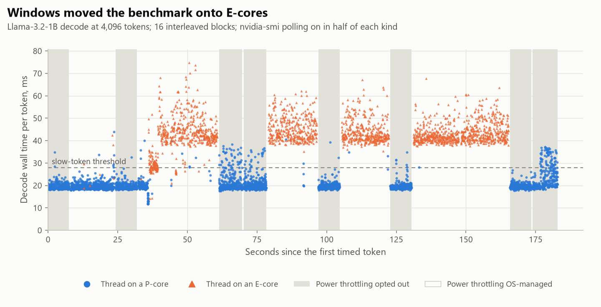
</picture>

Left to the OS, Windows moves a detached benchmark onto E-cores and decode takes
2.08× as long. Caught while
validating the instruments, before it could show up as a policy effect.

## Repository

| Path | |
|---|---|
| `lazykv/` | Runtime: caches, block pool, residency policies, CPU tier, kernels, quality metrics |
| `harness/` | Stats, telemetry, GPU memory guard, host scheduling, metrics I/O, template renderer |
| `scripts/` · `configs/` | Benchmark drivers, analyses, figures; one YAML per phase |
| `results/` | Raw `metrics.json` and telemetry for every reported run |
| [`docs/phases/`](docs/phases) | One report per phase (0–24), with method and provenance |
| [`docs/FINDINGS.md`](docs/FINDINGS.md) | The study in one document |
| [`docs/RESEARCH_LOG.md`](docs/RESEARCH_LOG.md) | Dated notes, including mistakes caught |
| [`SYSTEM_INFO.md`](SYSTEM_INFO.md) | Machine inventory and hardware microbenchmarks |
| [`AGENTS.md`](AGENTS.md) | Project rules: no hand-typed numbers, verified citations, phase gates |

## Scope

One machine (an RTX 5060 Laptop, see [SYSTEM_INFO.md](SYSTEM_INFO.md)), single request, single GPU.
Out of scope: batching, cross-request prefix caching, custom CUDA kernels, and competing with vLLM
on throughput. There is no SSD tier on the latency path: NVMe is
9.9× slower than pinned PCIe sequentially.
The 1B model's full 64K cache fits in VRAM, so the budget at that size is an imposed constraint that
makes policies comparable, not a physical limit.

## Citation

```bibtex
@software{lazykv,
  title  = {LazyKV: a tiered KV-cache runtime and residency-policy study for long-context inference on one 8 GB consumer GPU},
  author = {PS12007},
  url    = {https://github.com/PS12007/LazyKV},
  version = {0.1.0},
  year   = {2026}
}
```

## License

[MIT](LICENSE). Contributions, especially reproductions on other GPUs, are welcome; see
[CONTRIBUTING.md](CONTRIBUTING.md).
