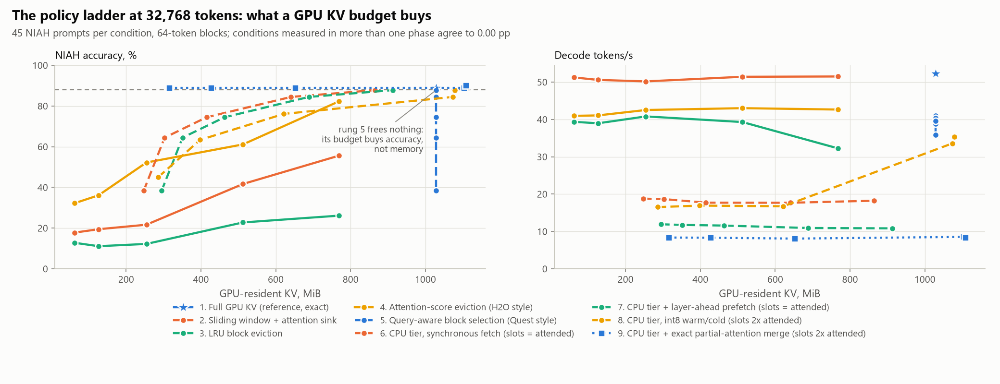
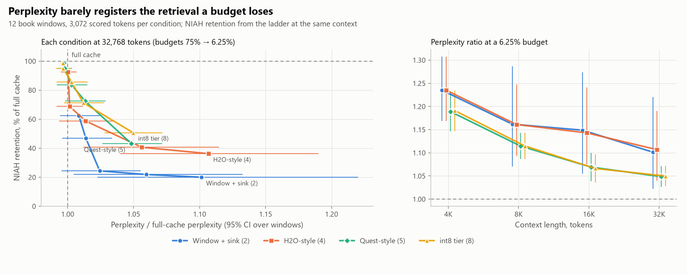
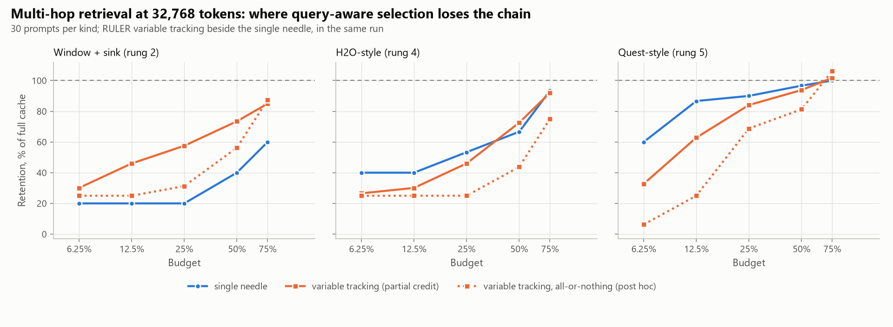

<!-- GENERATED by scripts/render_docs.py from docs/templates/FINDINGS.md.tmpl. Edit the template, not this file. Numbers come from results/**/metrics.json. -->

# Findings: what a GPU KV budget buys

> Under a fixed GPU KV budget, how much context and quality can be retained by intelligent block
> residency, migration, compression and prefetching?

**Short answer, at 32,768 tokens on one 8 GB laptop GPU.** Quality falls
smoothly with the budget, and the best approximating policy keeps
98.8% of the full cache's retrieval accuracy at a
75% budget. **No approximating policy
retains 99% at any budget below 100%**, the bar set before any data existed. Rung 9, which computes
the non-resident attention on the CPU instead of skipping it, clears the bar at every budget, at
6.2× the full cache's decode time. The last
percent of accuracy is available; it costs compute, not memory.

A second result was not predicted: every mechanism that reduced *bytes moved* failed to reduce
*latency*, because decode is bound by the host work that decides what to move.

Detail and provenance are in the [phase reports](phases/).

## 1. The headline number

> Minimum GPU KV budget at which policy P retains ≥ 99% of baseline NIAH accuracy at 32K context,
> and the tokens/sec at that point.

| Rung | Policy | Smallest budget retaining >= 99% | Best retention measured | at budget | Resident KV, MiB | Tokens/s there |
| ---: | --- | ---: | ---: | ---: | ---: | ---: |
| 1 | Full GPU KV (reference, exact) | 100% | 100.0% | 100% | 1,028 | 52.3 |
| 2 | Sliding window + attention sink | **none** | 62.5% | 75% | 768 | 51.5 |
| 3 | LRU block eviction | **none** | 29.4% | 75% | 768 | 32.2 |
| 4 | Attention-score eviction (H2O style) | **none** | 92.5% | 75% | 768 | 42.6 |
| 5 | Query-aware block selection (Quest style) | **none** | 98.8% | 75% | 1,028 | 35.9 |
| 6 | CPU tier, synchronous fetch | **none** | 98.8% | 75% | 865 | 18.2 |
| 7 | CPU tier + layer-ahead prefetch | **none** | 98.8% | 75% | 913 | 10.8 |
| 8 | CPU tier, int8 warm/cold | **none** | 98.8% | 75% | 1,078 | 35.4 |
| 9 | CPU tier + exact partial-attention merge | 6.25% | 101.3% | 75% | 1,108 | 8.4 |

Rungs 5 to 8 stop at 98.8% retention at a
75% budget, just under the
bar on 45 prompts. [Phase 8](phases/PHASE_8.md) repeated the sweep at four
contexts and found the query-aware rungs within one prompt of the bar every time (closest
0.07 prompts), landing on
alternating sides. The window with a sink misses by 13 to 17 prompts at every context; rung 9
clears at the smallest budget swept.

**[Phase 9](phases/PHASE_9.md) placed rung 5 as far as NIAH can**, on
300 paired prompts under a decision rule fixed in advance:

| Policy | Budget | Prompts | Retention | 95% CI (paired) | Verdict | Worse / better than full | Sign test p | Prompts to resolve |
| --- | ---: | ---: | ---: | ---: | --- | ---: | ---: | ---: |
| Quest-style (rung 5) | 75% | 300 | 99.0% | 97.6–100.2% | **unresolved** | 12 / 6 | 0.24 | ~580,000,000 |
| Quest-style (rung 5) | 50% | 300 | 96.9% | 94.7–98.9% | **fails** | 23 / 10 | 0.035 | ~300 |
| Block pool, 100% | 100% | 300 | 100.0% | 100.0–100.0% | **meets** | 0 / 0 | 1 | n/a (no discordant prompts) |

At 50% rung 5 **fails**: 96.9%, with the whole
95% CI (94.7%–98.9%)
below 99%. At 75% it retains 99.0%, CI
97.6%–100.2%:
six times the prompts narrowed the interval without moving it off the line. The 99% bar is finer
than NIAH can resolve here for any policy that lands near it.

**KL adds resolution, not a new headline.** On Phase 10's 12 paired book
windows, teacher-forced KL orders every adjacent pair of budgets within a rung
(64 of 64 resolved by an
exact sign test, 0 the wrong way), including the case
NIAH could not: rung 5 at 50% is further from the full cache than at 75% in
12 of 12 windows
(p = 0.0005; mean KL 7.5e-03
vs 2.3e-03 nats). Across rungs at equal budget it resolves
75 of 120 pairs; of the
45 it does not, 19
are rung 5 against rung 8, which make the same selection. KL says which condition is closer to the
full cache; it does not say whether the difference changes an answer.

**Rung 9 is exact.** It attends to non-resident blocks where they live, on the CPU, and merges the
two partial results with their log-sum-exp normalizers. Its accuracy does not depend on the budget,
so it meets the target at 6.25%, the
tightest swept.

| Rung | Policy | Smallest budget meeting the target | Retention there | Resident KV, MiB | Tokens/s |
| ---: | --- | ---: | ---: | ---: | ---: |
| 9 | CPU tier + exact partial-attention merge | 6.25% | 100.0% | 316 | 8.4 |

It decodes at 8.4 tokens/s against the full cache's
52.3, and needs host RAM the memory axis does not show
([Phase 7](phases/PHASE_7.md)). Its best cell,
101.3% at
75%, is above the cache it reproduces.
That is rounding, not improvement: the GPU half runs bf16 and the CPU half float32, so a prompt on a
near-tie can flip either way.

## 2. The frontier

<picture>
  <source media="(prefers-color-scheme: dark)" srcset="figures/ladder_pareto-dark.png">
  
</picture>

Up and to the left is better.

- **Rung 5 is a vertical line.** Query-aware selection attends to the top-K blocks but keeps every
  block resident, so its budget buys accuracy and not memory. Only the CPU tier (rungs 6+) turns it
  into a memory budget.
- **The cheap baselines are far off.** The window with a sink tops out at
  62.5%. Block LRU reaches 29.4%:
  it evicts a block before it can observe a use, so it degenerates to a window without a sink.
  Attention-score eviction reaches 92.5%.
- **Rung 9 is a horizontal line at the top**, and the right panel shows its price.
- **Every tier rung is low and flat on speed**, barely responding to how much KV is resident (§4).

## 3. Every rung, every budget

Phase 4 ran the tier with VRAM slots for exactly the attended set and for twice it; only the first
frees VRAM at the larger budgets. Rungs 8 and 9 were run only at 2×, so their memory columns are not
directly comparable to rungs 6 and 7.

| Rung | Policy | VRAM slots | Budget | NIAH accuracy [95% CI] | Retention | Resident KV, MiB | Tokens/s | Measured in |
| ---: | --- | --- | ---: | ---: | ---: | ---: | ---: | --- |
| 1 | Full GPU KV (reference, exact) | - | 100% | 88.9% [82, 95] | 100.0% | 1,028 | 52.3 | Phase 5 |
| 2 | Sliding window + attention sink | - | 75% | 55.6% [43, 68] | 62.5% | 768 | 51.5 | Phase 2 |
| 2 | Sliding window + attention sink | - | 50% | 41.7% [29, 54] | 46.9% | 512 | 51.4 | Phase 2 |
| 2 | Sliding window + attention sink | - | 25% | 21.7% [12, 32] | 24.4% | 254 | 50.2 | Phase 2 |
| 2 | Sliding window + attention sink | - | 12.5% | 19.4% [9, 30] | 21.9% | 126 | 50.6 | Phase 2 |
| 2 | Sliding window + attention sink | - | 6.25% | 17.8% [8, 28] | 20.0% | 62 | 51.2 | Phase 2 |
| 3 | LRU block eviction | - | 75% | 26.1% [15, 39] | 29.4% | 768 | 32.2 | Phase 2 |
| 3 | LRU block eviction | - | 50% | 22.8% [12, 36] | 25.6% | 512 | 39.3 | Phase 2 |
| 3 | LRU block eviction | - | 25% | 12.2% [4, 22] | 13.8% | 254 | 40.8 | Phase 2 |
| 3 | LRU block eviction | - | 12.5% | 11.1% [2, 20] | 12.5% | 126 | 39.0 | Phase 2 |
| 3 | LRU block eviction | - | 6.25% | 12.8% [4, 22] | 14.4% | 62 | 39.4 | Phase 2 |
| 4 | Attention-score eviction (H2O style) | - | 75% | 82.2% [73, 91] | 92.5% | 768 | 42.6 | Phase 3 |
| 4 | Attention-score eviction (H2O style) | - | 50% | 61.1% [49, 73] | 68.8% | 512 | 43.0 | Phase 3 |
| 4 | Attention-score eviction (H2O style) | - | 25% | 52.2% [40, 64] | 58.8% | 254 | 42.5 | Phase 3 |
| 4 | Attention-score eviction (H2O style) | - | 12.5% | 36.1% [24, 48] | 40.6% | 126 | 41.1 | Phase 3 |
| 4 | Attention-score eviction (H2O style) | - | 6.25% | 32.2% [20, 44] | 36.3% | 62 | 41.0 | Phase 3 |
| 5 | Query-aware block selection (Quest style) | - | 75% | 87.8% [81, 94] | 98.8% | 1,028 | 35.9 | Phase 4 |
| 5 | Query-aware block selection (Quest style) | - | 50% | 84.4% [76, 92] | 95.0% | 1,028 | 41.0 | Phase 4 |
| 5 | Query-aware block selection (Quest style) | - | 25% | 74.4% [63, 85] | 83.8% | 1,028 | 40.3 | Phase 4 |
| 5 | Query-aware block selection (Quest style) | - | 12.5% | 64.4% [52, 76] | 72.5% | 1,028 | 38.8 | Phase 4 |
| 5 | Query-aware block selection (Quest style) | - | 6.25% | 38.3% [26, 52] | 43.1% | 1,028 | 39.6 | Phase 4 |
| 6 | CPU tier, synchronous fetch | 2x attended | 75% | 87.8% [81, 94] | 98.8% | 1,108 | 35.3 | Phase 5 |
| 6 | CPU tier, synchronous fetch | = attended | 75% | 87.8% [81, 94] | 98.8% | 865 | 18.2 | Phase 4 |
| 6 | CPU tier, synchronous fetch | 2x attended | 50% | 84.4% [76, 92] | 95.0% | 1,103 | 32.9 | Phase 5 |
| 6 | CPU tier, synchronous fetch | = attended | 50% | 84.4% [76, 92] | 95.0% | 641 | 17.7 | Phase 4 |
| 6 | CPU tier, synchronous fetch | 2x attended | 25% | 74.4% [63, 85] | 83.8% | 652 | 19.2 | Phase 5 |
| 6 | CPU tier, synchronous fetch | = attended | 25% | 74.4% [63, 85] | 83.8% | 415 | 17.7 | Phase 4 |
| 6 | CPU tier, synchronous fetch | 2x attended | 12.5% | 64.4% [52, 76] | 72.5% | 428 | 19.2 | Phase 5 |
| 6 | CPU tier, synchronous fetch | = attended | 12.5% | 64.4% [52, 76] | 72.5% | 303 | 18.7 | Phase 4 |
| 6 | CPU tier, synchronous fetch | 2x attended | 6.25% | 38.3% [26, 52] | 43.1% | 316 | 18.7 | Phase 5 |
| 6 | CPU tier, synchronous fetch | = attended | 6.25% | 38.3% [26, 52] | 43.1% | 247 | 18.8 | Phase 4 |
| 7 | CPU tier + layer-ahead prefetch | 2x attended | 75% | 87.8% [81, 94] | 98.8% | 1,173 | 24.2 | Phase 4 |
| 7 | CPU tier + layer-ahead prefetch | = attended | 75% | 87.8% [81, 94] | 98.8% | 913 | 10.8 | Phase 4 |
| 7 | CPU tier + layer-ahead prefetch | 2x attended | 50% | 84.4% [76, 92] | 95.0% | 1,167 | 24.2 | Phase 4 |
| 7 | CPU tier + layer-ahead prefetch | = attended | 50% | 84.4% [76, 92] | 95.0% | 689 | 10.9 | Phase 4 |
| 7 | CPU tier + layer-ahead prefetch | 2x attended | 25% | 74.4% [63, 85] | 83.8% | 716 | 12.8 | Phase 4 |
| 7 | CPU tier + layer-ahead prefetch | = attended | 25% | 74.4% [63, 85] | 83.8% | 463 | 11.6 | Phase 4 |
| 7 | CPU tier + layer-ahead prefetch | 2x attended | 12.5% | 64.4% [52, 76] | 72.5% | 492 | 12.7 | Phase 4 |
| 7 | CPU tier + layer-ahead prefetch | = attended | 12.5% | 64.4% [52, 76] | 72.5% | 351 | 11.8 | Phase 4 |
| 7 | CPU tier + layer-ahead prefetch | 2x attended | 6.25% | 38.3% [26, 52] | 43.1% | 380 | 12.3 | Phase 4 |
| 7 | CPU tier + layer-ahead prefetch | = attended | 6.25% | 38.3% [26, 52] | 43.1% | 295 | 11.9 | Phase 4 |
| 8 | CPU tier, int8 warm/cold | 2x attended | 75% | 87.8% [81, 94] | 98.8% | 1,078 | 35.4 | Phase 5 |
| 8 | CPU tier, int8 warm/cold | 2x attended | 50% | 84.4% [76, 92] | 95.0% | 1,073 | 33.6 | Phase 5 |
| 8 | CPU tier, int8 warm/cold | 2x attended | 25% | 76.1% [66, 86] | 85.6% | 622 | 16.7 | Phase 5 |
| 8 | CPU tier, int8 warm/cold | 2x attended | 12.5% | 63.3% [51, 76] | 71.2% | 398 | 16.9 | Phase 5 |
| 8 | CPU tier, int8 warm/cold | 2x attended | 6.25% | 45.0% [32, 58] | 50.6% | 286 | 16.5 | Phase 5 |
| 9 | CPU tier + exact partial-attention merge | 2x attended | 75% | 90.0% [83, 96] | 101.3% | 1,108 | 8.4 | Phase 7 |
| 9 | CPU tier + exact partial-attention merge | 2x attended | 50% | 88.9% [82, 95] | 100.0% | 1,103 | 8.6 | Phase 7 |
| 9 | CPU tier + exact partial-attention merge | 2x attended | 25% | 88.9% [82, 95] | 100.0% | 652 | 8.1 | Phase 7 |
| 9 | CPU tier + exact partial-attention merge | 2x attended | 12.5% | 88.9% [82, 95] | 100.0% | 428 | 8.3 | Phase 7 |
| 9 | CPU tier + exact partial-attention merge | 2x attended | 6.25% | 88.9% [82, 95] | 100.0% | 316 | 8.4 | Phase 7 |

## 4. Fewer bytes, no faster

PCIe is far slower than VRAM, so dense refetch is out and selection is mandatory. That holds. What
the design did not predict is that once selection makes transfers small, they stop being the cost.

| Attack on bytes moved | Phase | Result |
|---|---|---|
| Double VRAM slots at 25%, cutting fetches from 2,828 to 295 pairs/token | 4 | 17.7 → 18.6 tokens/s |
| Layer-ahead prefetch, hiding 100% of copies | 4 | **slower** than synchronous fetch |
| int8 warm/cold tier, halving bytes on the wire | 5 | **1.14× slower** |
| Remove the per-layer host sync (replay ablation) | 6, 11 | 1.10–1.25× faster: the ceiling |
| Move no KV at all: attend where it lives (rung 9) | 7 | **2.28–4.23× slower**, and exact |

Rung 9 returns only 113.8 KiB per token and is
the slowest rung on the ladder. Whatever bounds this decode, it is not the link.

The cause is the same each time: every selecting layer brings its top-K indices to the CPU before it
can decide what to fetch, and that round trip costs more than the transfer. [Phase 8](phases/PHASE_8.md)
showed it is a per-layer constant: at least 76%
of the manager cost sits at zero blocks, and sixteen times the blocks costs no measurably more. At
25% the tier moves 4.5 MiB per token (under a
millisecond of link time) while host select time is
20–28 ms.

**The ceiling on fixing that is measured.** A replay ablation records each layer's selection and
decodes again from the record, fetching identical blocks without the bound or its sync. Over
3 runs that is worth
1.10–1.25×
([Phase 11](phases/PHASE_11.md)); its fastest, 23.8 ms
per token, is still slower than the full cache's 18.8 ms.
These figures replace Phase 6's, whose replay raced on its pinned staging buffers
([Phase 9](phases/PHASE_9.md) §5; normal decode is unaffected). On the
6 shared conditions the ceiling fell from
1.11–1.16×
to 1.10–1.14×.

That ceiling applies to rung 6's data path. [Phase 23](phases/PHASE_23.md) dropped the residency
table along with the sync, gathering selected blocks straight from mapped host memory, and decodes
at rung 5's speed at 6.25%.

## 5. Other quality measures

### Perplexity misses retrieval loss

<picture>
  <source media="(prefers-color-scheme: dark)" srcset="figures/p10_perplexity-dark.png">
  
</picture>

[Phase 10](phases/PHASE_10.md) ran long-document perplexity for rungs 2, 4, 5 and 8 at
4 contexts. At
32,768 tokens, 9
of 20 conditions lose at least a tenth of
NIAH retrieval while their perplexity interval includes no change; the window with a sink at
25% keeps
24.4% of retrieval at
1.024× perplexity. Perplexity ranks
conditions roughly right (Spearman 0.94
against NIAH loss) but hides the size of the loss, because the few tokens that need distant context
are averaged with the many that don't (the problem LongPPL, arXiv 2410.23771, addresses). A fixed
fraction also costs *less* perplexity at longer context, in all
13 conditions resolved at
4,096 tokens, while retrieval cost is set by the
fraction (Phase 8).

### Multi-hop retrieval

<picture>
  <source media="(prefers-color-scheme: dark)" srcset="figures/p12_ruler-dark.png">
  
</picture>

A needle is the best case for query-aware selection: the question names what to look for.
[Phase 12](phases/PHASE_12.md) added RULER variable tracking, where only the first of five chained
assignments holds the value the question names. Down to 25%, Quest-style selection is still the
best rung on both tasks. At 6.25% it keeps
50%–63%
of the needle but 15%–37%
of variable tracking across four contexts, and its lead over the cheap baselines disappears.
[Phase 13](phases/PHASE_13.md) reran 32K with 150
prompts per task: at 6.25% the shortfall is **established**
(41.5% vs
61.3%, disjoint intervals); at 12.5% it is
not (69.4% vs
81.3%). RULER's aggregation task was beyond
this model at every context.

### LongBench

[Phase 14](phases/PHASE_14.md) ran rungs 2, 4 and 5 on four LongBench QA subsets. No multi-hop
shortfall was detected: at 6.25% selection keeps
77.2% of multi-hop F1 and
78.6% of single-document F1, but the
difference interval (-21.1 pp to
+16.6 pp) still contains Phase 13's gap. Every
rung loses far less here than on needles (the window at 25% keeps
72.2%–76.2%
of F1 against 24.4% of
NIAH), which is why the headline stays on needle retrieval: it discriminates.

### A larger model

[Phase 15](phases/PHASE_15.md) ran rungs 2, 4, 5 and 6 on Llama-3.2-3B (nf4 weights, bf16 KV) at
16,384 tokens, on the same
45 prompts as the 1B. At 6.25%, selection keeps
76.7% of the 3B's accuracy against
42.9% of the 1B's (difference
+19.8 pp to
+48.2 pp), resolved at 12.5% too. No model
difference is detected for the window, and rung 6 matched rung 5 on every prompt. The 1B's losses
look like a conservative estimate, but this is one extra model, not a trend.

## 6. Why the phases share one frontier

The rungs were measured weeks apart, so combining them needs evidence. Adjacent phases overlap
deliberately. Comparable sweeps: **True**; overlapping conditions:
17; largest accuracy disagreement:
**0.00 pp**.

| Condition | Budget | Phases | Largest accuracy gap | Largest tokens/s ratio |
| --- | ---: | --- | ---: | ---: |
| Block pool, 100% | 100% | P2, P3, P4, P5, P7 | 0.00 pp | 1.042x |
| Full cache (rung 1) | 100% | P2, P3, P4, P5, P7 | 0.00 pp | 1.120x |
| Quest-style (rung 5) | 75% | P3, P4 | 0.00 pp | 1.125x |
| Quest-style (rung 5) | 50% | P3, P4 | 0.00 pp | 1.001x |
| Quest-style (rung 5) | 25% | P3, P4 | 0.00 pp | 1.012x |
| Quest-style (rung 5) | 12.5% | P3, P4 | 0.00 pp | 1.036x |
| Quest-style (rung 5) | 6.25% | P3, P4 | 0.00 pp | 1.010x |
| CPU tier, sync fetch (rung 6) | 75% | P4, P5, P7 | 0.00 pp | 1.014x |
| CPU tier, sync fetch (rung 6) | 50% | P4, P5, P7 | 0.00 pp | 1.127x |
| CPU tier, sync fetch (rung 6) | 25% | P4, P5, P7 | 0.00 pp | 1.058x |
| CPU tier, sync fetch (rung 6) | 12.5% | P4, P5, P7 | 0.00 pp | 1.018x |
| CPU tier, sync fetch (rung 6) | 6.25% | P4, P5, P7 | 0.00 pp | 1.027x |
| Window + sink (rung 2) | 75% | P2, P3 | 0.00 pp | 1.010x |
| Window + sink (rung 2) | 50% | P2, P3 | 0.00 pp | 1.000x |
| Window + sink (rung 2) | 25% | P2, P3 | 0.00 pp | 1.015x |
| Window + sink (rung 2) | 12.5% | P2, P3 | 0.00 pp | 1.011x |
| Window + sink (rung 2) | 6.25% | P2, P3 | 0.00 pp | 1.065x |

Accuracy reproduces to the prompt. Speed varies up to
1.13× for the same condition across phases
(thermal and run-to-run variation), which is why every latency claim is quoted as a range over
independent runs.

## 7. Limitations

- **Mostly one model.** Llama-3.2-1B on NIAH with 45 prompts per condition,
  plus perplexity, RULER (rungs 2, 4, 5) and four LongBench subsets. The 3B ran only at
  16,384 tokens, on NIAH, with 4-bit weights.
- **One context for the frontier.** Phase 8 swept 4
  contexts for rungs 2, 5, 6 and 9 and found the budget *fraction* travels
  2.7× better than a fixed token budget; the
  other rungs were not checked.
- **Wide intervals.** Differences smaller than a few points are not resolvable at
  45 prompts. Only rung 5 at 50% and 75% was rerun on
  300.
- **Rung 9 is exact in the algebra, not the bits.** bf16 on the GPU and float32 on the CPU give a KL
  of about 1e-03 nats and top-1 agreement of
  97.9%–98.6%,
  3–114×
  closer than the rung it replaces. Its float32 mirror costs
  1,848 MiB of host RAM.
- **Prefill was full-cache in these experiments.** [Phase 17](phases/PHASE_17.md) later added a
  bit-identical tiered prefill that lifts the context limit to what host RAM holds.
- **Single-turn.** In multi-turn sessions ([Phase 19](phases/PHASE_19.md)), rung 5 at 6.25% answers
  24.3% of later turns fed
  token by token and 72.9%
  with dense turn reads. Since [Phase 21](phases/PHASE_21.md) the tier reads turns densely and keeps
  77.3% of the full
  cache's later turns. One model, one context, 20 sessions.
- **The fast kernel is not bit-repeatable** for single-query decode, so quality is scored on a
  deterministic kernel.
- **A laptop.** Thermal effects are controlled by interleaving and repetition, not eliminated.
